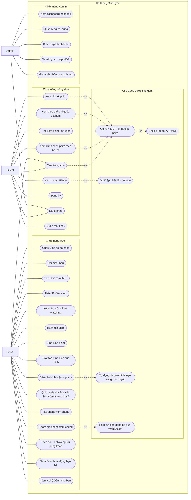
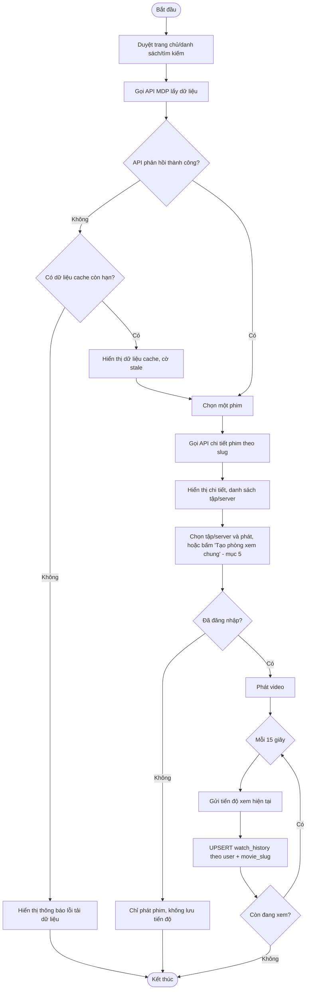
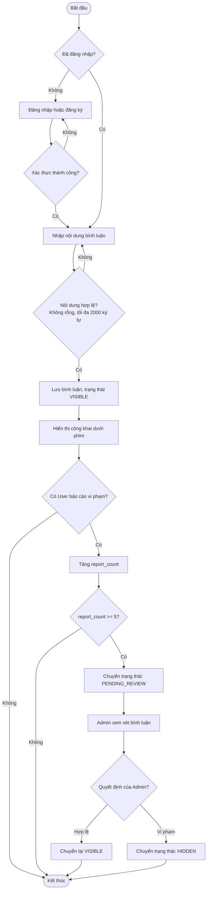
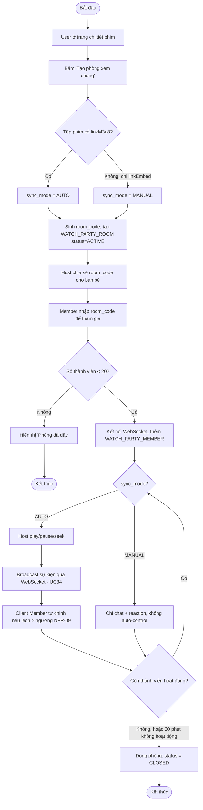
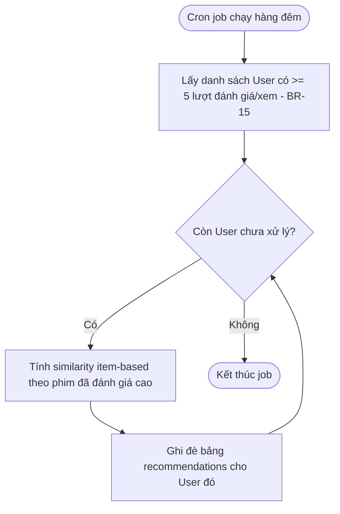

# Use Case Diagram và Activity Diagram – CineSync

## 1. Quy ước

- Actor gồm: `Guest`, `User`, `Admin`.
- Dữ liệu phim lấy qua **MDP** (Movie Data Provider — nhà cung cấp dữ liệu phim bên thứ ba, tên/endpoint thật không public, xem `01_CineSync_Business_Analysis.md` mục 8.1); khóa tham chiếu phim là `movie_slug`.
- Trong một phòng Watch Party, một `User` giữ vai trò tạm thời Host hoặc Member — không phải actor riêng, không thể hiện trên Use Case Diagram.
- Mã Use Case trong sơ đồ (`UC01`, `UC02`...) là mã **nội bộ của tài liệu diagram này**, khác với mã `UC-G/U/A-xx` trong BA — có bảng đối chiếu ở mục 8.

## 2. Use Case Diagram

### 2.1. Ghi chú Use Case

- `UC20`/`UC21` (Tạo/Tham gia phòng xem chung) chỉ dành cho User; `UC21` bao gồm việc phát/nhận sự kiện đồng bộ qua WebSocket (`UC34`) khi phòng ở chế độ `AUTO`.
- `UC22`/`UC23`/`UC24` (Follow, Feed, Gợi ý) là nhóm tính năng xã hội — không có Use Case tương ứng bên Guest.
- `UC28`/`UC29` là 2 màn hình giám sát của Admin: log tích hợp MDP (kế thừa từ nhu cầu theo dõi tình trạng bên thứ ba) và giám sát Watch Party.
- Mọi lời gọi tới `UC30` (API MDP) đều được ghi log qua `UC32`, phục vụ `UC28`.

## 3. Activity Diagram – Quy trình xem phim và ghi lịch sử

### 3.1. Kết quả của quy trình xem phim

- Nếu API MDP lỗi nhưng có dữ liệu cache hợp lệ, User vẫn xem được danh sách (BR-08), kèm cảnh báo dữ liệu có thể chưa mới nhất.
- Tiến độ xem chỉ được lưu khi User đã đăng nhập; Guest xem phim bình thường nhưng không có "Xem tiếp".
- Mỗi phim/tập chỉ giữ **một** bản ghi tiến độ mới nhất cho mỗi User (không lưu lịch sử từng lần xem).

## 4. Activity Diagram – Quy trình bình luận và kiểm duyệt

### 4.1. Quy tắc chuyển trạng thái bình luận

| Trạng thái hiện tại | Sự kiện | Trạng thái sau xử lý | Ghi chú |
|---|---|---|---|
| VISIBLE | User gửi bình luận hợp lệ | VISIBLE | Hiển thị công khai ngay. |
| VISIBLE | Bị báo cáo, `report_count` < 5 | VISIBLE | Chưa đủ ngưỡng, chưa can thiệp. |
| VISIBLE | Bị báo cáo, `report_count` >= 5 | PENDING_REVIEW | Ưu tiên vào hàng chờ duyệt của Admin. |
| PENDING_REVIEW | Admin xác nhận hợp lệ | VISIBLE | Bình luận hiển thị lại bình thường. |
| PENDING_REVIEW | Admin xác nhận vi phạm | HIDDEN | Ẩn khỏi công khai, giữ lại để tra cứu. |
| Bất kỳ | Chủ bình luận tự xóa | (xóa cứng) | User chỉ xóa được bình luận của chính mình. |

## 5. Activity Diagram – Watch Party (Tạo & tham gia phòng xem chung) **(MỚI)**

### 5.1. Kết quả của quy trình Watch Party

- Nếu Host rời phòng giữa chừng, quyền Host chuyển cho Member tham gia sớm nhất tiếp theo (không thể hiện trên sơ đồ để giữ gọn, xem BR-13/mục 4.5 BA).
- Chat trong phòng không lưu DB vĩnh viễn (BR-14) — luồng gửi/nhận chat không ghi vào Activity Diagram vì đây là I/O tức thời qua WebSocket, không có bước xử lý nghiệp vụ phức tạp.

## 6. Activity Diagram – Gợi ý cá nhân hóa (batch job hàng đêm) **(MỚI)**

> User chưa đủ 5 lượt đánh giá/xem không được job này xử lý; khi họ mở màn hình "Dành cho bạn", Backend tính fallback "Phim thịnh hành" trực tiếp theo lượt Yêu thích nội bộ (không cần batch job riêng vì tính đơn giản, thực hiện real-time).

## 7. Kiểm tra nhất quán với tài liệu BA

| Nội dung | Thể hiện trong sơ đồ |
|---|---|
| Watch Party chỉ đồng bộ tự động khi có `linkM3u8` (giả định 1.10, BR-11) | Nhánh `CheckSrc` trong Activity Diagram mục 5 |
| Giới hạn 20 thành viên/phòng (BR-12) | Nhánh `CheckFull` trong Activity Diagram mục 5 |
| Phòng tự đóng sau 30 phút không hoạt động (BR-13) | Nhánh `Loop1` → `CloseRoom` |
| Gợi ý yêu cầu tối thiểu 5 lượt đánh giá/xem (BR-15) | Bước `GetUsers` trong Activity Diagram mục 6 |
| Đồng bộ MDP graceful degradation (BR-08) | Nhánh `Cache` trong Activity Diagram mục 3 |

## 8. Đối chiếu mã sơ đồ với Business Analysis

| Mã sơ đồ | Mã Use Case trong BA |
|---|---|
| `UC01`–`UC09` | `UC-G-01` đến `UC-G-11` (kế thừa, gộp một số hành động liên quan) |
| `UC10`–`UC19` | `UC-U-01` đến `UC-U-09` |
| `UC20`–`UC24` | `UC-U-10` đến `UC-U-14` |
| `UC25`–`UC29` | `UC-A-01` đến `UC-A-06` (`UC-A-01` Đăng nhập quản trị dùng chung `UC08`) |
| `UC30`–`UC34` | Hành động con, không có mã Use Case độc lập trong BA (tương ứng mục 8 – Tích hợp bên thứ ba). |
