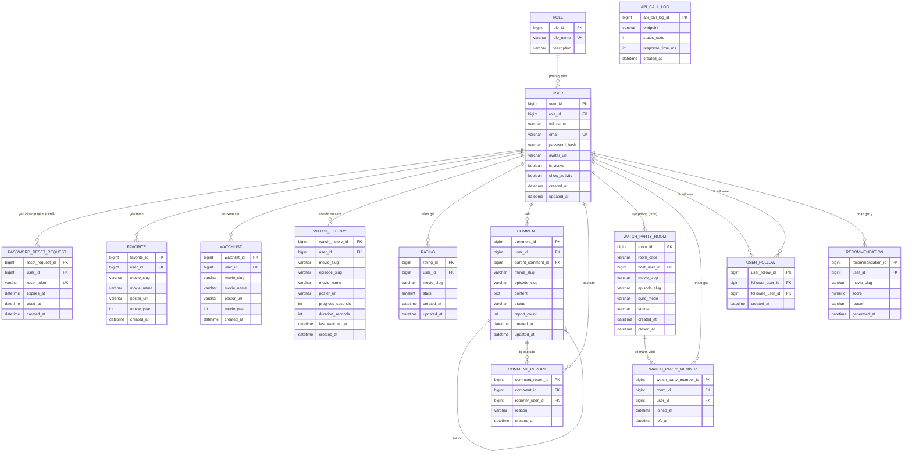

# ERD – CineSync

## 1. Mục đích và giả định thiết kế

ERD này được xây dựng từ các entity nghiệp vụ nội bộ trong `01_CineSync_Business_Analysis.md` (mục 7), gồm 10 entity nền tảng (`ROLE`, `USER`, `PASSWORD_RESET_REQUEST`, `FAVORITE`, `WATCHLIST`, `WATCH_HISTORY`, `RATING`, `COMMENT`, `COMMENT_REPORT`, `API_CALL_LOG`) và 4 entity mới phục vụ Watch Party và lớp xã hội.

Các giả định bổ sung so với ERD gốc:

- **`WATCH_PARTY_ROOM`** và **`WATCH_PARTY_MEMBER`** dùng `movie_slug` làm khóa tham chiếu logic (giống các entity khác), không FK tới phim.
- **`USER_FOLLOW`** tự tham chiếu tới `USER` qua hai khóa ngoại (`follower_user_id`, `followee_user_id`) — tương tự cách `COMMENT` tự tham chiếu qua `parent_comment_id`.
- **`RECOMMENDATION`** không có ràng buộc `UNIQUE` cứng theo (`user_id`, `movie_slug`) vì được ghi đè theo lô (batch overwrite) mỗi lần job chạy, không `UPSERT` từng dòng — đây là lựa chọn thiết kế có chủ đích để đơn giản hóa job (YAGNI).
- CineSync triển khai trên PostgreSQL (giả định 1.9 trong BA), đúng định hướng công nghệ đã chọn.

## 2. Entity Relationship Diagram

## 3. Mô tả entity và khóa chính/khóa ngoại

| Entity | Khóa chính | Khóa ngoại | Vai trò trong hệ thống |
|---|---|---|---|
| ROLE | `role_id` | Không có | Lưu vai trò User hoặc Admin. |
| USER | `user_id` | `role_id` → ROLE | Lưu tài khoản, thông tin cá nhân, xác thực, trạng thái hoạt động, quyền riêng tư Feed. |
| PASSWORD_RESET_REQUEST | `reset_request_id` | `user_id` → USER | Lưu yêu cầu đặt lại mật khẩu có thời hạn. |
| FAVORITE | `favorite_id` | `user_id` → USER | Lưu tham chiếu phim được User yêu thích (theo `movie_slug`, không FK vật lý tới bảng phim). |
| WATCHLIST | `watchlist_id` | `user_id` → USER | Lưu tham chiếu phim User đánh dấu xem sau. |
| WATCH_HISTORY | `watch_history_id` | `user_id` → USER | Lưu tiến độ xem mới nhất của User cho từng phim/tập. |
| RATING | `rating_id` | `user_id` → USER | Lưu điểm đánh giá 1–5 sao của User cho một phim. |
| COMMENT | `comment_id` | `user_id` → USER; `parent_comment_id` → COMMENT (tự tham chiếu) | Lưu bình luận/trả lời bình luận theo phim (và tùy chọn theo tập). |
| COMMENT_REPORT | `comment_report_id` | `comment_id` → COMMENT; `reporter_user_id` → USER | Lưu từng lượt báo cáo vi phạm với một bình luận. |
| API_CALL_LOG | `api_call_log_id` | Không có | Lưu log lời gọi API MDP (nhà cung cấp dữ liệu phim) phục vụ theo dõi tình trạng tích hợp. |
| **WATCH_PARTY_ROOM** | `room_id` | `host_user_id` → USER | Lưu thông tin 1 phòng xem chung: phim, chế độ đồng bộ, trạng thái. |
| **WATCH_PARTY_MEMBER** | `watch_party_member_id` | `room_id` → WATCH_PARTY_ROOM; `user_id` → USER | Ghi lịch sử tham gia phòng, phục vụ thống kê Admin (UC-A-06); trạng thái real-time trong phòng quản lý qua WebSocket, không qua bảng này. |
| **USER_FOLLOW** | `user_follow_id` | `follower_user_id` → USER; `followee_user_id` → USER | Quan hệ theo dõi 1 chiều giữa 2 User. |
| **RECOMMENDATION** | `recommendation_id` | `user_id` → USER | Lưu kết quả gợi ý cá nhân hóa do batch job tính toán. |

## 4. Ràng buộc dữ liệu và nghiệp vụ cần áp dụng

| ID | Ràng buộc |
|---|---|
| ERD-R-01 | `USER.email`, `PASSWORD_RESET_REQUEST.reset_token` phải là duy nhất toàn hệ thống. |
| ERD-R-02 | Cặp `FAVORITE.user_id` và `FAVORITE.movie_slug` phải là duy nhất (BR-02). |
| ERD-R-03 | Cặp `WATCHLIST.user_id` và `WATCHLIST.movie_slug` phải là duy nhất (BR-03). |
| ERD-R-04 | Cặp `WATCH_HISTORY.user_id`, `movie_slug`, `episode_slug` (coi `episode_slug` rỗng là một giá trị hợp lệ với phim lẻ) phải là duy nhất; mỗi lần cập nhật tiến độ là `UPSERT` trên bộ khóa này. |
| ERD-R-05 | Cặp `RATING.user_id` và `RATING.movie_slug` phải là duy nhất (BR-04); cập nhật lại `stars` khi gửi lần sau thay vì tạo bản ghi mới. |
| ERD-R-06 | `RATING.stars` chỉ nhận giá trị nguyên từ 1 đến 5. |
| ERD-R-07 | `COMMENT.content` không được để trống, tối đa 2000 ký tự (BR-05). |
| ERD-R-08 | `COMMENT.status` chỉ nhận một trong các giá trị: `VISIBLE`, `PENDING_REVIEW`, `HIDDEN`. |
| ERD-R-09 | `COMMENT.parent_comment_id`, nếu có, phải trỏ đến một COMMENT khác thuộc cùng `movie_slug`; không cho phép trả lời một COMMENT đã có `parent_comment_id` (chỉ 1 cấp trả lời). |
| ERD-R-10 | Cặp `COMMENT_REPORT.comment_id` và `COMMENT_REPORT.reporter_user_id` phải là duy nhất; một User chỉ báo cáo một bình luận tối đa 1 lần. |
| ERD-R-11 | Khi số dòng `COMMENT_REPORT` của một `COMMENT` đạt 5, tầng Service phải cập nhật `COMMENT.status = 'PENDING_REVIEW'` trong cùng transaction với việc ghi `COMMENT_REPORT`. |
| ERD-R-12 | `FAVORITE.movie_slug`, `WATCHLIST.movie_slug`, `WATCH_HISTORY.movie_slug`, `RATING.movie_slug`, `COMMENT.movie_slug` không được để trống; đây là khóa tham chiếu logic tới dữ liệu phim của MDP, không có ràng buộc khóa ngoại vật lý. |
| ERD-R-13 | `WATCH_HISTORY.progress_seconds` không được vượt quá `duration_seconds` (khi `duration_seconds` khác NULL). |
| ERD-R-14 | `WATCH_PARTY_ROOM.room_code` chỉ bắt buộc duy nhất trong số phòng đang `ACTIVE` (unique index có điều kiện `WHERE status = 'ACTIVE'`) — cho phép tái sử dụng mã sau khi phòng `CLOSED`, tránh cạn không gian mã 6 ký tự. |
| ERD-R-15 | `WATCH_PARTY_ROOM.sync_mode` chỉ nhận `AUTO` hoặc `MANUAL`; `status` chỉ nhận `ACTIVE` hoặc `CLOSED`. |
| ERD-R-16 | `WATCH_PARTY_MEMBER` không có ràng buộc duy nhất theo (`room_id`, `user_id`) — một User có thể rời rồi vào lại cùng một phòng nhiều lần trong phiên, mỗi lần là một bản ghi mới (`left_at NULL` = đang trong phòng). |
| ERD-R-17 | Cặp `USER_FOLLOW.follower_user_id` và `USER_FOLLOW.followee_user_id` phải duy nhất (BR-16); `follower_user_id` phải khác `followee_user_id` (không tự follow chính mình). |
| ERD-R-18 | `RECOMMENDATION` không có ràng buộc `UNIQUE` cứng theo (`user_id`, `movie_slug`) — bảng được xóa và ghi lại toàn bộ cho mỗi User mỗi khi batch job chạy (mục 4.6 BA), không `UPSERT` từng dòng. |

## 5. Ghi chú triển khai ERD

- Toàn bộ cột thời gian nên lưu theo UTC (`timestamptz`); tầng ứng dụng quy đổi theo múi giờ trình duyệt khi hiển thị.
- Không mô hình hóa entity `MOVIE`, `CATEGORY`, `COUNTRY` trong ERD này vì đây là dữ liệu do MDP sở hữu và trả về động qua API; nếu tương lai cần lọc/thống kê nâng cao theo thể loại nội bộ, có thể bổ sung bảng cache có TTL riêng (không bắt buộc ở giai đoạn 1 theo YAGNI).
- `API_CALL_LOG` có thể triển khai dưới dạng bảng xoay vòng (retention ví dụ 30 ngày, dọn định kỳ) để tránh phình dữ liệu vận hành; cột `endpoint` chỉ nên lưu tên endpoint **nội bộ** CineSync (VD `movies.home`, `movies.detail`), không lưu domain/đường dẫn thật của MDP (tránh lộ thông tin nhạy cảm nếu log bị truy cập ngoài ý muốn).
- Chỉ mục nên ưu tiên theo `(user_id, movie_slug)` cho `FAVORITE`, `WATCHLIST`, `RATING`, và `(user_id, last_watched_at DESC)` cho `WATCH_HISTORY`.
- Trạng thái real-time của một phòng Watch Party (ai đang online, đang phát tới giây thứ mấy) **không** lưu DB — chỉ tồn tại trong bộ nhớ của tiến trình WebSocket (Socket.IO). `WATCH_PARTY_MEMBER` chỉ ghi lại "đã từng tham gia" phục vụ audit/thống kê, không phải nguồn sự thật (source of truth) cho trạng thái phòng đang chạy.
- `WATCH_PARTY_ROOM` nên có job định kỳ (vài phút/lần) quét các phòng `ACTIVE` quá 30 phút không có sự kiện phát để tự chuyển `CLOSED` (BR-13) — thực hiện ở tầng ứng dụng (Node cron), không phải trigger DB, vì "hoạt động phát" là sự kiện WebSocket chứ không phải write DB.
- Chỉ mục nên ưu tiên: `(host_user_id)` cho `WATCH_PARTY_ROOM`; `(follower_user_id)` và `(followee_user_id)` riêng cho `USER_FOLLOW`; `(user_id, score DESC)` cho `RECOMMENDATION` để lấy nhanh top gợi ý.
