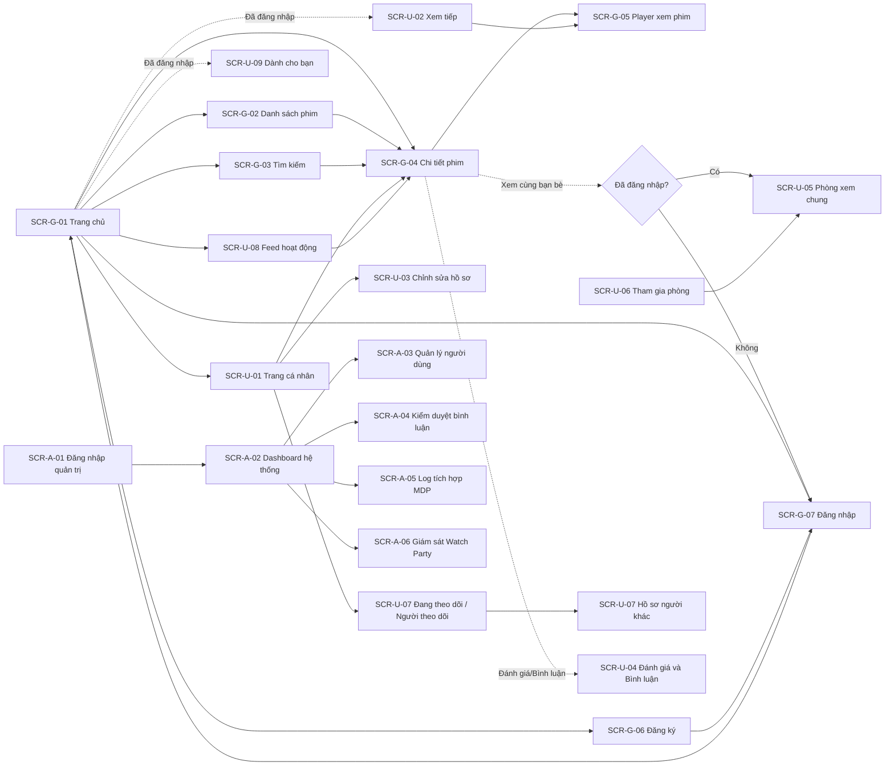

# Wireframe Specification – CineSync

## 1. Design System tóm tắt

- **Tông màu chủ đạo**: Nền tối kiểu rạp chiếu (`bg-neutral-950`), Card `bg-neutral-900`, Accent đỏ/cam nổi bật (`bg-rose-600`, `hover:bg-rose-700`, `text-rose-500`) cho CTA và badge, chữ chính `text-neutral-100`, chữ phụ `text-neutral-400`.
- **Badge/nhãn phim**: `HD`/`4K`/`FullHD` (từ `quality`) — nhãn nhỏ góc poster; `Vietsub`/`Lồng tiếng`/`Thuyết minh` (từ `lang`) — badge nhỏ cạnh nhãn chất lượng; `Tập {episode_current}/{episode_total}` với phim bộ; Badge `Đã lưu` (Yêu thích/Xem sau) hiển thị icon trái tim/đồng hồ đã tô màu khi User đã tương tác.
- **Component dùng lại**: `Button`, `Input`, `Select`, `Badge`, `Modal`, `Toast`, `Spinner`, `EmptyState`, `Pagination`, `StarRating` (component sao bấm được), `MoviePosterCard`, `VideoPlayer` (wrapper cho HLS/embed), `CommentItem` (hỗ trợ 1 cấp trả lời).
- **Layout chuẩn**: Header cố định trên cùng (logo, menu Thể loại/Quốc gia/Năm, ô Tìm kiếm, nút Đăng nhập/Avatar); nội dung dạng lưới poster (grid) responsive theo carousel ở trang chủ.
- **Responsive**: Desktop lưới 6-8 cột poster; Tablet 4 cột; Mobile 2-3 cột, Header thu gọn thành icon tìm kiếm + menu hamburger.

**Component mới (MỚI):**
- `RoomCodeBadge` — hiển thị mã phòng 6 ký tự dạng to, có nút "Copy" nhanh.
- `ReactionOverlay` — lớp phủ trong suốt trên Player, hiển thị emoji bay lên theo vị trí ngẫu nhiên khi có sự kiện `reaction`.
- `ChatPanel` — khung chat trượt cạnh Player trong Watch Party, tự cuộn xuống tin mới nhất.
- `MemberAvatarStack` — dải avatar chồng nhau thể hiện thành viên đang trong phòng.
- `FollowButton` — nút 2 trạng thái "Theo dõi" / "Đang theo dõi", optimistic UI giống nút Yêu thích.
- `ActivityFeedItem` — 1 dòng feed: avatar + tên + hành động + phim liên quan + thời gian.

## 2. Màn hình Guest / Công khai

### SCR-G-01 — Trang chủ
- **Bố cục**: Banner lớn (slider) giới thiệu vài phim nổi bật/mới; bên dưới là chuỗi carousel ngang theo từng nhóm: "Mới cập nhật", "Phim lẻ", "Phim bộ", "Phim 4K", "Đang chiếu" — mỗi carousel gọi API danh sách theo bộ lọc tương ứng, có nút "Xem tất cả" dẫn sang `SCR-G-02`.
- **Mỗi poster card**: ảnh `thumb_url`, tên phim, badge chất lượng/ngôn ngữ, hover hiện thêm năm + nút Play nhanh (Desktop).
- **Loading**: Skeleton dạng khung poster xám cho từng carousel trong lúc chờ API.
- **Lỗi tải dữ liệu**: Nếu một carousel lỗi (API MDP không phản hồi và không có cache), ẩn carousel đó, không chặn phần còn lại của trang (NFR-02/BR-08).

### SCR-G-02 — Danh sách phim (theo bộ lọc/thể loại/quốc gia/năm)
- **Bố cục**: Thanh tiêu đề (ví dụ "Phim bộ", "Thể loại: Hành động"); Thanh filter phụ (Quốc gia, Năm, Sắp xếp) nếu API hỗ trợ; Lưới poster + Pagination cuối trang.
- **Trạng thái rỗng**: Không có phim khớp bộ lọc — hình minh họa + gợi ý quay lại trang chủ.

### SCR-G-03 — Tìm kiếm
- **Bố cục**: Ô tìm kiếm nổi bật trên Header, gõ tối thiểu 2 ký tự mới gọi API (debounce ~400ms); kết quả hiển thị dạng dropdown gợi ý nhanh (5-8 kết quả) hoặc chuyển sang trang kết quả đầy đủ khi bấm Enter/"Xem tất cả kết quả".
- **Trạng thái rỗng**: "Không tìm thấy phim phù hợp với '{keyword}'".

### SCR-G-04 — Chi tiết phim *(cập nhật)*
- **Bố cục**: Banner nền mờ từ `poster_url`; bên trái poster chính (`thumb_url`), bên phải: tên phim (`name` + `origin_name`), badge chất lượng/ngôn ngữ/năm, điểm đánh giá nội bộ (⭐ trung bình + số lượt) — tách biệt hoàn toàn khỏi bất kỳ điểm đánh giá nào MDP có thể trả kèm (nếu có, hiển thị riêng có chú thích nguồn); mô tả (`content`); danh sách diễn viên/đạo diễn; danh sách thể loại/quốc gia (dạng chip, click để sang `SCR-G-02` lọc theo mục đó).
- **Khu vực hành động**: nút "Xem phim" (primary), nút icon Yêu thích, nút icon Xem sau — disable + mở Modal đăng nhập nếu Guest bấm. Bổ sung nút **"Xem cùng bạn bè"** cạnh nút "Xem phim" — bấm vào mở Modal tạo phòng (chọn tập nếu là phim bộ) → điều hướng sang `SCR-U-05`. Nút này cũng **disable + mở Modal đăng nhập** nếu Guest bấm.
- **Khu vực tập phim**: nếu phim bộ, hiển thị lưới số tập (`episode_current`/`episode_total`), click một tập để mở Player với tập đó.
- **Khu vực bình luận**: danh sách bình luận (`SCR-U-04` nhúng) ở cuối trang.

### SCR-G-05 — Player xem phim
- **Bố cục**: Khung Player toàn chiều rộng ở trên; bên dưới chọn Server phát (nếu phim có nhiều server, dạng tab); với phim bộ có thanh chọn nhanh tập kế tiếp/trước.
- **Hành vi**: Nếu User đã đăng nhập, cứ mỗi ~15 giây gửi tiến độ xem hiện tại lên Backend (im lặng, không hiện Toast mỗi lần); khi rời trang/đóng tab, cố gắng gửi một lần cuối (`beforeunload`/`visibilitychange`).
- **Lỗi phát**: Nếu server hiện tại lỗi, hiện Toast gợi ý "Server này có vẻ đang lỗi, thử server khác?" kèm nút chuyển nhanh.
- **Guest**: Xem phim bình thường như User, chỉ không có tiến độ xem/"Xem tiếp" được lưu lại.

### SCR-G-06 — Đăng ký
- **Bố cục**: Form: Họ tên, Email, Mật khẩu, Xác nhận mật khẩu, nút "Đăng ký". Mở dưới dạng Modal nổi trên bất kỳ trang nào để không làm gián đoạn trải nghiệm xem phim.

### SCR-G-07 — Đăng nhập
- **Bố cục**: Form Email, Mật khẩu, nút "Đăng nhập", link "Quên mật khẩu?"; cũng ưu tiên dạng Modal như `SCR-G-06`.
- **Trạng thái**: Toast lỗi khi sai thông tin hoặc tài khoản bị khóa ("Tài khoản của bạn đã bị khóa").

### SCR-G-08 — Quên mật khẩu / Đặt lại mật khẩu
- **Bố cục**: Form nhập Email → thông báo kiểm tra email (không tiết lộ email tồn tại hay không) → link trong email dẫn tới form Mật khẩu mới + Xác nhận.

## 3. Màn hình User (bổ sung so với Guest)

### SCR-U-01 — Trang cá nhân (Hồ sơ)
- **Bố cục**: Tab ngang: "Yêu thích", "Xem sau", "Đã xem gần đây", "Bình luận của tôi"; mỗi tab là lưới poster tương tự `SCR-G-02` nhưng có thêm nút "Bỏ" nhanh trên mỗi card (icon X góc trên).
- **Trạng thái rỗng theo từng tab**: ví dụ tab Yêu thích rỗng — "Bạn chưa yêu thích phim nào 🎬" + nút "Khám phá phim ngay".
- **(MỚI)** Bổ sung 2 mục trong menu: "Đang theo dõi" và "Người theo dõi" (dẫn sang `SCR-U-07`).

### SCR-U-02 — Xem tiếp (Continue watching)
- **Vị trí**: Một carousel riêng ngay đầu trang chủ khi User đã đăng nhập và có ít nhất 1 mục lịch sử xem (thay thế/đứng trước carousel "Mới cập nhật").
- **Mỗi card**: poster kèm thanh tiến độ (progress bar) mỏng phía dưới ảnh thể hiện % đã xem; click vào mở thẳng Player tại đúng vị trí đã dừng.

### SCR-U-03 — Chỉnh sửa hồ sơ / Đổi mật khẩu
- **Bố cục**: Form Họ tên, Ảnh đại diện (upload hoặc chọn URL), Email (readonly); tab riêng Đổi mật khẩu (Mật khẩu hiện tại, Mật khẩu mới, Xác nhận). **(MỚI)** thêm tab "Quyền riêng tư" với toggle `showActivity`.

### SCR-U-04 — Thành phần Đánh giá & Bình luận (nhúng trong SCR-G-04)
- **Đánh giá**: 5 icon sao có thể bấm chọn; hiển thị điểm trung bình + tổng lượt đánh giá cạnh đó; nếu User đã đánh giá trước, hiển thị sẵn số sao đã chọn, cho phép sửa.
- **Bình luận**: Ô nhập bình luận + nút "Gửi" ở trên cùng khu vực; danh sách bình luận bên dưới, mỗi bình luận có: avatar, tên, nội dung, thời gian, nút "Trả lời" (chỉ hiện ở bình luận gốc, ẩn ở bình luận trả lời), nút "..." (menu Sửa/Xóa nếu là bình luận của mình, hoặc "Báo cáo" nếu là bình luận người khác).
- **Báo cáo**: Bấm "Báo cáo" mở Modal nhỏ chọn lý do (tùy chọn) → Toast xác nhận "Đã ghi nhận báo cáo, cảm ơn bạn"; nút chuyển thành "Đã báo cáo" (disable) sau khi gửi.

### SCR-U-05 — Phòng xem chung (Watch Party Room) **(MỚI)**
- **Bố cục**: Player chiếm phần lớn màn hình bên trái (giống `SCR-G-05`), `ReactionOverlay` phủ lên trên; bên phải là `ChatPanel` (thu gọn được trên Mobile thành tab dưới Player). Đầu trang: `RoomCodeBadge` + `MemberAvatarStack` + nút "Rời phòng".
- **Chế độ `AUTO`**: chỉ Host thấy đầy đủ nút điều khiển Player (play/pause/seek); Member thấy Player ở chế độ chỉ xem, có dòng nhỏ "Đang đồng bộ với Host". Nếu lệch quá ngưỡng, hiển thị toast nhỏ "Đã đồng bộ lại".
- **Chế độ `MANUAL`**: hiển thị dải cảnh báo phía trên Player "Server này không hỗ trợ đồng bộ tự động — cùng đếm 3-2-1 qua chat nhé!"; mọi thành viên đều có nút điều khiển Player riêng.
- **Mất kết nối**: nếu WebSocket rớt, hiển thị badge nhỏ "Đang kết nối lại..." góc trên `ChatPanel`, tự reconnect (NFR-10), không chặn việc tiếp tục xem.
- **Trạng thái rỗng**: khi phòng chỉ có 1 mình Host, hiển thị gợi ý "Chia sẻ mã phòng để mời bạn bè" nổi bật cạnh `RoomCodeBadge`.

### SCR-U-06 — Tham gia phòng xem chung **(MỚI)**
- **Bố cục**: Modal nhỏ, 1 ô nhập mã phòng 6 ký tự, nút "Tham gia". Có thể mở từ Header (icon riêng) hoặc từ link chia sẻ trực tiếp (`/watch-party/{roomCode}`).
- **Lỗi**: Toast "Phòng không tồn tại hoặc đã đóng" / "Phòng đã đầy".

### SCR-U-07 — Trang cá nhân của người khác + Follow **(MỚI)**
- **Bố cục**: Xem hồ sơ công khai của 1 User khác (tên, avatar, số người theo dõi/đang theo dõi), `FollowButton` nổi bật đầu trang; bên dưới (tùy chọn) danh sách hoạt động công khai gần đây nếu `showActivity = true`.
- Trang cá nhân của chính mình (`SCR-U-01`) bổ sung 2 mục trong menu: "Đang theo dõi" và "Người theo dõi" (danh sách dạng lưới avatar + tên + `FollowButton`).

### SCR-U-08 — Feed hoạt động bạn bè **(MỚI)**
- **Vị trí**: Một panel/tab riêng, có thể truy cập từ Header hoặc nhúng dưới carousel "Xem tiếp" ở trang chủ (dạng rút gọn 5 dòng mới nhất + link "Xem tất cả").
- **Mỗi dòng** (`ActivityFeedItem`): avatar + "{Tên} vừa {đánh giá 5⭐ / thêm vào Yêu thích / bình luận về} {tên phim}" + thời gian tương đối ("2 giờ trước"); click vào tên phim mở `SCR-G-04`.
- **Trạng thái rỗng**: "Bạn chưa theo dõi ai — khám phá và kết nối với người xem phim khác 🎬" + nút gợi ý một vài User đang hoạt động nhiều (tùy chọn mở rộng).

### SCR-U-09 — Dành cho bạn (Gợi ý cá nhân hóa) **(MỚI)**
- **Vị trí**: Carousel riêng ở trang chủ, đặt sau carousel "Xem tiếp" (`SCR-U-02` cũ), chỉ hiển thị khi User đã đăng nhập.
- Nếu `isFallbackTrending = true` (chưa đủ dữ liệu cá nhân hóa), đổi tiêu đề carousel thành "Phim thịnh hành" thay vì "Dành cho bạn", không để trống hoàn toàn.

## 4. Màn hình Admin

### SCR-A-01 — Đăng nhập quản trị
- **Bố cục**: Tương tự `SCR-G-07` nhưng theme tối giản riêng cho khu vực quản trị, chỉ chấp nhận tài khoản có vai trò `ADMIN`.

### SCR-A-02 — Dashboard hệ thống
- **Bố cục**: Thẻ số liệu: Tổng User, User hoạt động hôm nay, Tổng Yêu thích, Tổng Đánh giá, Tổng Bình luận; bảng "Top 10 phim được yêu thích nhiều nhất" (tên phim, số lượt, poster nhỏ); khối cảnh báo nếu tỷ lệ lỗi gọi API MDP trong 24h vượt ngưỡng (liên kết sang `SCR-A-05`).

### SCR-A-03 — Quản lý người dùng
- **Bố cục**: Bảng danh sách User (Họ tên, Email, Trạng thái, Ngày tạo), ô tìm kiếm theo email/tên, filter theo trạng thái hoạt động; mỗi dòng có nút "Khóa"/"Mở khóa" kèm Modal xác nhận.

### SCR-A-04 — Kiểm duyệt bình luận
- **Bố cục**: Danh sách bình luận, mặc định lọc `PENDING_REVIEW` (ưu tiên xử lý), có thể chuyển filter sang `VISIBLE`/`HIDDEN`; mỗi dòng hiển thị: nội dung bình luận, tên phim liên quan, người viết, số lượt báo cáo, 2 nút hành động "Duyệt hợp lệ" / "Ẩn bình luận".
- **Trạng thái rỗng**: "Không có bình luận nào đang chờ duyệt 🎉".

### SCR-A-05 — Log tích hợp MDP
- **Bố cục**: Biểu đồ đường thời gian phản hồi trung bình theo giờ/ngày; bảng chi tiết log gần nhất (endpoint **nội bộ**, mã trạng thái, thời gian phản hồi, thời điểm gọi — không hiển thị domain/đường dẫn thật của MDP); filter theo khoảng thời gian và endpoint.

### SCR-A-06 — Giám sát phòng xem chung **(MỚI)**
- **Bố cục**: Bảng danh sách phòng (mã phòng, phim, Host, số thành viên hiện tại, chế độ đồng bộ, trạng thái, thời gian tạo); filter theo `ACTIVE`/`CLOSED`; nút "Đóng cưỡng chế" cho phòng đang `ACTIVE` kèm Modal xác nhận.
- **Thẻ số liệu đầu trang**: Tổng số phòng đang hoạt động, tổng thành viên đang online (tổng hợp qua Socket.IO, không phải query DB).

## 5. Luồng điều hướng chính (Navigation Flow)

## 6. Ghi chú triển khai UI

- Đăng ký/Đăng nhập ưu tiên hiển thị dạng **Modal nổi** trên mọi trang thay vì chuyển route riêng, để không làm gián đoạn luồng xem phim/duyệt phim của Guest.
- Mọi thao tác Yêu thích/Xem sau/Đánh giá phải phản hồi tức thì (optimistic UI): cập nhật icon ngay khi bấm, rollback nếu API lỗi kèm Toast.
- Khi API MDP trả dữ liệu cache (`stale: true`), hiển thị dải cảnh báo nhỏ, không chặn (ví dụ text nhỏ "Dữ liệu có thể chưa được cập nhật mới nhất" phía trên danh sách).
- Dùng `react-toastify`/`hot-toast` cho phản hồi thao tác thành công/lỗi ở mọi màn hình User; riêng `SCR-G-05` (Player) hạn chế Toast che khuất khung phát, ưu tiên hiển thị cảnh báo nhỏ góc trên.
- `SCR-U-05` (Phòng xem chung) hạn chế Toast che khuất Player giống `SCR-G-05` — ưu tiên badge nhỏ góc trên thay vì Toast lớn cho sự kiện đồng bộ.
- `FollowButton` và optimistic UI: cập nhật trạng thái ngay khi bấm, rollback nếu API lỗi — cùng pattern với nút Yêu thích đã có.
- `RoomCodeBadge` nên hỗ trợ Web Share API trên Mobile (chia sẻ link phòng trực tiếp qua app nhắn tin) thay vì chỉ copy text, cải thiện trải nghiệm mời bạn bè.
- Kết nối WebSocket nên hiển thị trạng thái rõ ràng (đã kết nối / đang kết nối lại / mất kết nối) — không để người dùng "xem một mình" mà không biết đã rớt kết nối.
