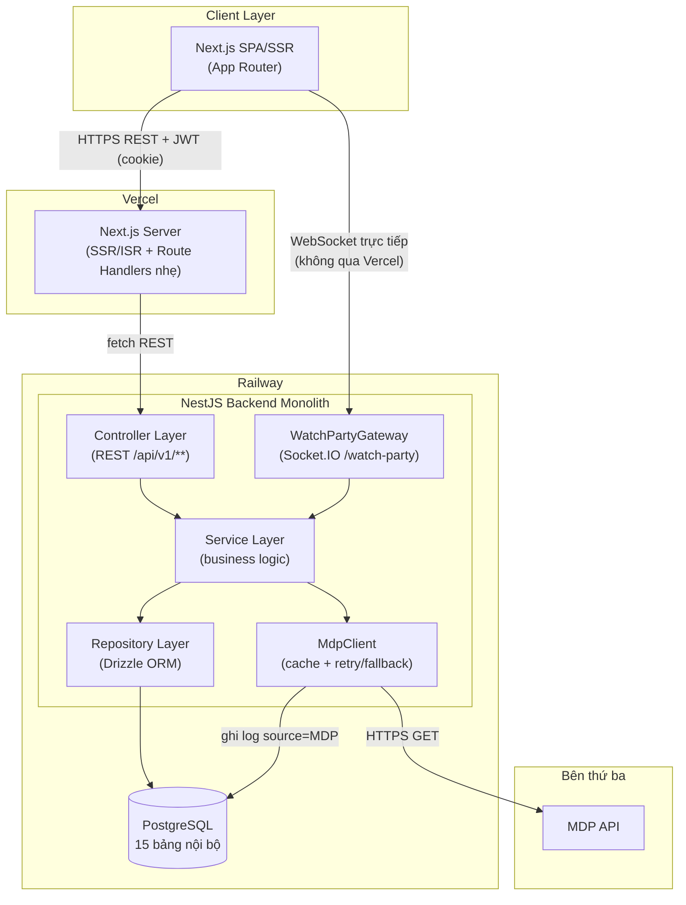
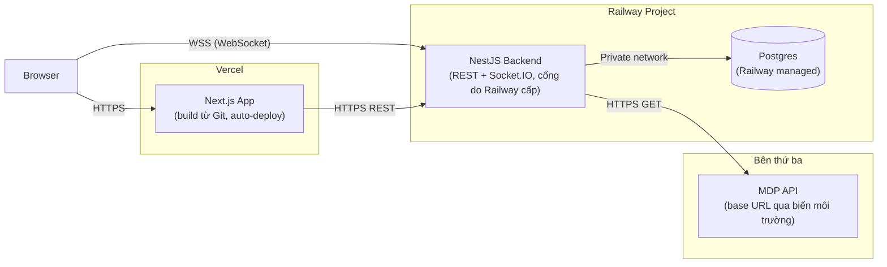

# Kiến trúc Hệ thống – CineSync

> **Lưu ý bảo mật thông tin**: Repo này dự kiến public/forkable. Tên và endpoint cụ thể của nhà cung cấp dữ liệu phim bên thứ ba **không** được ghi trong tài liệu này — chỉ gọi tắt là **MDP** (Movie Data Provider), đúng quy ước ở `01_CineSync_Business_Analysis.md`. Base URL thật cấu hình qua biến môi trường `MOVIE_PROVIDER_BASE_URL` trong `.env` cục bộ, không commit vào Git.

## 1. Tổng quan

CineSync áp dụng triết lý thiết kế đơn giản KISS/YAGNI (1 backend monolith, dữ liệu phim lấy từ MDP, không Microservices/Message Queue), triển khai trên nền tảng PaaS (Vercel + Railway), và có 1 điểm phức tạp cần xử lý cẩn thận: **tầng WebSocket cho Watch Party** phải chạy trên tiến trình dài hạn (không dùng được serverless function).

| Thành phần | Công nghệ | Ghi chú |
|---|---|---|
| Backend API + WebSocket | **NestJS** (Node.js 22 LTS, TypeScript) | 1 service duy nhất, gồm cả REST và Socket.IO Gateway. NestJS được chọn vì tư duy Module/Controller/Service/DI, Guard cho JWT gần với Spring Boot (dễ chuyển tư duy). |
| ORM / Query | **Drizzle ORM** + `node-postgres` (`pg`) | Schema khai báo gần với SQL thuần, hợp phong cách viết DDL/trigger tay trực tiếp (xem `cinesync_postgresql_schema.sql`). |
| Web Frontend | **Next.js 15+ (App Router)**, TailwindCSS, TanStack Query, Socket.IO client | SSR/ISR cho trang công khai (SEO), Client Component cho Player/Watch Party/Chat. |
| Database | **PostgreSQL 16+** | Chỉ 1 CSDL (giả định 1.9 BA) — không còn bản song song SQL Server. |
| Real-time | **Socket.IO**, chạy chung tiến trình với NestJS (namespace `/watch-party`) | Không dùng Redis pub/sub ở giai đoạn 1 — 1 instance Backend là đủ cho quy mô vài chục phòng đồng thời (NFR liên quan Watch Party). |
| Nguồn dữ liệu phim | **MDP** (Movie Data Provider) | Public, không cần token, JSON/UTF-8 — chi tiết định danh không public trong repo (xem lưu ý đầu tài liệu). |
| Hosting Backend | **Railway** | Chạy Node process dài hạn — bắt buộc cho WebSocket bền. |
| Hosting Database | **Railway Postgres** | Template Postgres mặc định của Railway là đủ, không cần extension đặc biệt. |
| Hosting Frontend | **Vercel** | Tận dụng SSR/ISR/Edge Middleware của Next.js. |

## 2. Sơ đồ kiến trúc tổng thể



> **Lưu ý kiến trúc quan trọng**: Client kết nối WebSocket **thẳng tới Railway**, không đi qua Vercel — vì Vercel Serverless Functions không giữ được kết nối bền. Route Handler của Next.js trên Vercel chỉ dùng cho các việc nhẹ (VD: đặt/đọc cookie JWT httpOnly), không phải reverse proxy chính cho toàn bộ API.

## 3. Kiến trúc Backend (NestJS)

```
src/
├── modules/
│   ├── auth/                 # AuthController, AuthService, JwtStrategy, Guards
│   ├── movies/                # Proxy MDP: home/list/search/genres/countries/years/detail
│   ├── favorites/ watchlists/ watch-history/ ratings/ comments/
│   │                           # nghiệp vụ tương tác phim (Favorite/Watchlist/History/Rating/Comment)
│   ├── watch-party/            # (MỚI) WatchPartyController (REST) + WatchPartyGateway (Socket.IO)
│   ├── social/                 # (MỚI) FollowController, FeedController
│   ├── recommendations/        # (MỚI) RecommendationsController + cron job (nightly)
│   └── admin/                  # Dashboard, Users, Comments, ApiLogs, WatchPartyMonitor
├── integration/
│   └── mdp-client.ts           # cache TTL theo loại endpoint, retry, fallback khi MDP lỗi
├── db/
│   ├── schema.ts               # Drizzle schema, map 1-1 với cinesync_postgresql_schema.sql
│   └── migrations/
├── common/                     # Guards (JWT, Roles), Interceptors, ApiResponse envelope
└── main.ts                     # Bootstrap NestJS + đăng ký Socket.IO adapter
```

### 3.1. `WatchPartyGateway` — thành phần trọng tâm mới

- Là 1 `@WebSocketGateway()` NestJS trong cùng process với REST API (không phải service riêng) — giữ đúng tinh thần monolith/KISS.
- Quản lý trạng thái phòng **hoàn toàn trong bộ nhớ** (Map `roomCode -> { members, syncMode, hostUserId }`); DB (`watch_party_rooms`, `watch_party_members`) chỉ ghi khi tạo/đóng phòng và khi có người vào/rời — phục vụ audit (UC-A-06), không phải nguồn sự thật cho trạng thái đang chạy (đúng ghi chú ERD mục 5).
- Middleware xác thực Socket.IO validate JWT lấy từ `handshake.auth.token` (cùng `JwtStrategy` với REST) trước khi cho phép `join_room`.
- 1 `@Cron()` job (dùng `@nestjs/schedule`) quét mỗi 5 phút các phòng `ACTIVE` quá 30 phút không có sự kiện phát → tự đóng (BR-13).
- **Giới hạn quy mô 1**: vì state nằm trong bộ nhớ 1 process, nếu Railway scale ngang nhiều instance Backend, các phòng sẽ "kẹt" theo từng instance (member nối vào instance khác nhau sẽ không thấy nhau). Ở target quy mô hiện tại (vài chục phòng đồng thời — Non-goal 1.4 BA), 1 instance là đủ; nếu cần scale ngang sau này, cần thêm Socket.IO Redis Adapter (ghi chú dự phòng mục 7, không triển khai ở giai đoạn 1).

## 4. Kiến trúc Frontend (Next.js App Router)

```
app/
├── (public)/
│   ├── page.tsx                 # Trang chủ — Server Component (SSR), fetch song song list + feed rút gọn
│   ├── movies/[slug]/page.tsx    # Chi tiết phim — Server Component (SEO), nút tương tác là Client Component con
│   ├── search/page.tsx           # Tìm kiếm theo từ khóa — Client Component (debounce)
│   └── watch-party/[roomCode]/page.tsx  # (MỚI) Client Component toàn phần (Player + Socket.IO + Chat)
├── (user)/
│   ├── profile/                  # Hồ sơ, Follow lists
│   ├── feed/                     # (MỚI) Feed hoạt động
│   └── settings/
├── (admin)/
│   └── admin/...
├── api/
│   └── auth/                     # Route Handler nhẹ: set/clear cookie JWT httpOnly khi login/logout
├── components/
│   ├── movie/ comment/ common/    # component tái sử dụng (MoviePosterCard, CommentItem, Button, Modal...)
│   └── watch-party/                # (MỚI) ChatPanel, ReactionOverlay, MemberAvatarStack, RoomCodeBadge
├── lib/
│   ├── api-client.ts               # fetch wrapper gọi thẳng Railway Backend (server & client đều dùng được)
│   └── socket-client.ts            # (MỚI) khởi tạo/kết nối Socket.IO, xử lý reconnect
└── context/
    └── AuthContext.tsx
```

- **Server Component cho trang công khai** (trang chủ, chi tiết phim, danh sách) — tận dụng SSR/ISR của Next.js để tải nhanh và tốt cho SEO, đúng tinh thần "tận dụng sức mạnh Next.js" đã đề ra ban đầu; các nút tương tác (Yêu thích, Xem sau, Tạo phòng...) là Client Component nhỏ nhúng vào.
- **Watch Party là Client Component toàn phần** — cần `useEffect`/state cho kết nối Socket.IO, không phù hợp Server Component.
- Không dùng Redux — Context API cho Auth, TanStack Query cho cache dữ liệu fetch từ Backend cho các phần không phải real-time.

## 5. Bảo mật

- Dùng Stateless JWT. Token lưu trong **cookie `httpOnly` + `Secure` + `SameSite=Lax`** (không dùng `localStorage`), set bởi Route Handler `app/api/auth/*` của Next.js khi đăng nhập.
  - Lý do chọn cookie `httpOnly` thay vì `localStorage`: Server Component (chạy trên Vercel, phía server) cần đọc được token để gọi API cá nhân hóa (VD trang chủ SSR cần biết User đã đăng nhập để hiển thị "Xem tiếp"/"Dành cho bạn") — `localStorage` chỉ tồn tại phía trình duyệt, Server Component không đọc được.
  - Lợi ích bảo mật đi kèm: `httpOnly` cookie giảm rủi ro XSS đánh cắp token so với `localStorage`.
- Socket.IO xác thực bằng JWT gửi qua `handshake.auth.token` (client đọc từ cookie qua Route Handler trung gian trả về token ngắn hạn cho việc connect, tránh gửi cookie httpOnly trực tiếp qua giao thức WebSocket).
- CORS trên Railway Backend chỉ allow-list domain Vercel (production + preview domains).
- Nội dung Comment và Chat trong Watch Party đều được lọc/escape trước khi hiển thị (XSS) vì đều là nội dung do User tự nhập, hiển thị công khai cho người khác xem.

## 6. Kiến trúc triển khai (Deployment)



- **Vercel**: connect repo Git (thư mục `web/`), build tự động mỗi push, biến môi trường gồm `NEXT_PUBLIC_API_URL` (trỏ Railway) và `NEXT_PUBLIC_WS_URL`.
- **Railway**: 2 service trong cùng 1 project — (1) NestJS Backend (deploy từ Dockerfile hoặc Nixpacks tự nhận diện Node), (2) Postgres dùng template mặc định của Railway Marketplace (không cần extension đặc biệt).
- Biến môi trường Backend: `DATABASE_URL` (Railway tự inject qua private network), `JWT_SECRET`, `MOVIE_PROVIDER_BASE_URL`, `CORS_ORIGIN`. **Không commit giá trị thật của `MOVIE_PROVIDER_BASE_URL`** — chỉ khai báo tên biến trong `.env.example`, giá trị thật set trực tiếp trên dashboard Railway (xem lưu ý đầu tài liệu).
- Không cần tự quản Nginx/VPS/`systemd` — cả 2 nền tảng PaaS (Vercel, Railway) tự lo reverse proxy, TLS, và restart tiến trình khi crash.
- Migration DB chạy trong pipeline deploy của Railway (`drizzle-kit migrate` như 1 bước pre-deploy), không chạy tay như file `.sql` độc lập ở môi trường production (file `cinesync_postgresql_schema.sql` vẫn dùng tốt cho việc khởi tạo DB local/dev).

## 7. Giới hạn kiến trúc (Non-goals)

Non-goals: không tự host video, không crawl toàn bộ catalog MDP vào DB riêng, không Microservices/Message Queue, không recommendation engine deep learning tự huấn luyện, không SLA đảm bảo cho dữ liệu phim bên thứ ba, không tìm kiếm bằng AI/semantic search ở giai đoạn 1 (Non-goal 1.3 BA — chỉ tìm kiếm từ khóa + bộ lọc). Bổ sung:

- ❌ Không dùng Redis/Socket.IO Adapter để scale ngang Backend ở giai đoạn 1 — 1 instance Railway là đủ cho quy mô mục tiêu; đây là điểm cần làm trước tiên nếu sau này scale (ghi chú dự phòng, không bắt buộc).
- ❌ Không đảm bảo đồng bộ Watch Party tuyệt đối cho mọi nguồn phim — phụ thuộc `linkM3u8` vs `linkEmbed` (giả định 1.11 BA), đây là giới hạn của bên thứ ba MDP, không phải giới hạn kỹ thuật có thể khắc phục ở tầng CineSync.
